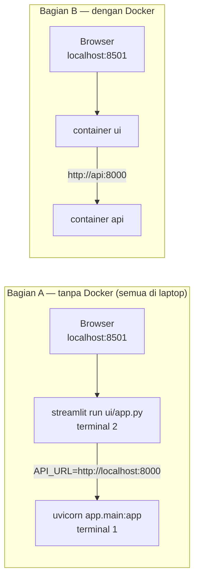
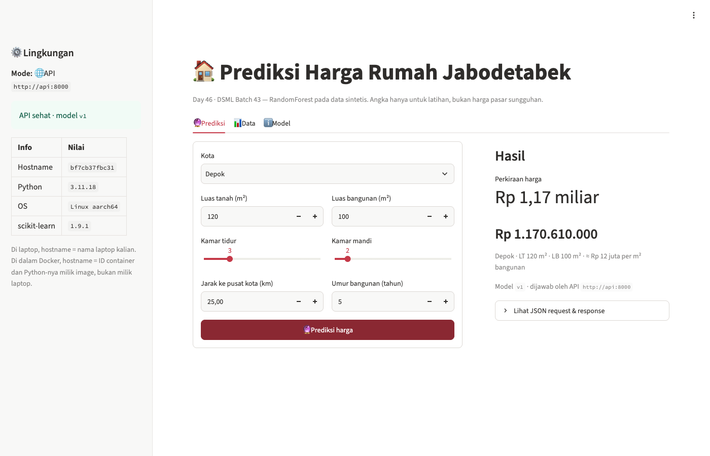

# Day 46 Hands-on — Prediksi Harga Rumah: tanpa Docker vs dengan Docker

Repo latihan **DSML Batch 43 · Day 46: Dockerized Deployment**. Isinya satu aplikasi ML lengkap:

- **Model**: RandomForest (scikit-learn) untuk menaksir harga rumah Jabodetabek dari data sintetis.
- **API**: FastAPI dengan endpoint `/health` dan `/predict`.
- **UI**: Streamlit berisi form prediksi, grafik data, dan info model.

Kalian akan menjalankan aplikasi yang **sama** dua kali: pertama langsung di laptop, kedua di dalam Docker.




📘 **Buku panduan peserta (PDF):** [`docs/Buku-Panduan-Peserta-Day-46.pdf`](docs/Buku-Panduan-Peserta-Day-46.pdf), versi lengkap langkah demi langkah dengan gambar dan lembar kerja.

---

## 1. Tujuan

Hari ini kalian akan **merasakan** dua hal:

1. **Repotnya tanpa Docker.** Kalian harus punya Python versi yang pas, membuat venv, memasang ±45 paket,
   membuka dua terminal, dan mengetik environment variable dengan benar. Kalau laptop teman kalian berbeda
   (Python 3.13, scikit-learn versi lain), hasilnya bisa gagal atau berbeda.
2. **Leganya dengan Docker.** Cukup satu perintah: `docker compose up -d --build`. Python, library, model,
   dan konfigurasi sudah dikunci di dalam *image*, jadi hasilnya sama di laptop siapa pun.

Di akhir sesi kalian bisa menjelaskan dengan kata-kata sendiri: apa itu **image**, **container**,
**layer cache**, **port mapping**, dan kenapa **container itu sekali pakai**.

---

## 2. Prasyarat

Install **sebelum kelas**:

| Software | Catatan |
|---|---|
| **Python 3.11** | Windows: installer dari python.org, centang *Add python.exe to PATH*. Cek: `py -3.11 --version`. macOS: `brew install python@3.11`. Cek: `python3.11 --version` |
| **Docker Desktop** | Windows: pilih backend **WSL 2** saat install. Cek: `docker version` harus menampilkan bagian *Server* |
| **VS Code** | Buka terminal lewat *Terminal → New Terminal* |
| **Git** | Untuk `git clone` |

Download image dasar di rumah karena ukurannya besar dan wifi kelas bisa lambat:

```bash
docker pull python:3.11-slim
docker pull python:3.11
docker run --rm hello-world
```

✅ **Checkpoint:** `docker run --rm hello-world` mencetak *Hello from Docker!*

> `python:3.11` (±1 GB download, ±3 GB di disk) hanya dipakai di Bagian C · Eksperimen 3.
> Kalau disk sempit, lewati saja image itu.

**Konvensi perintah.** Semua perintah dijalankan dari folder repo ini. Perintah `docker …` sama persis
di Windows dan macOS. Bedanya hanya di bagian berikut:

| | Windows (PowerShell) | macOS / Linux |
|---|---|---|
| Buat venv | `py -3.11 -m venv .venv` | `python3.11 -m venv .venv` |
| Aktifkan venv | `.venv\Scripts\activate` | `source .venv/bin/activate` |
| Set env var | `$env:API_URL="http://localhost:8000"` (berlaku sampai terminal ditutup) | `API_URL=http://localhost:8000 <perintah>` (hanya untuk perintah itu) |
| Hapus env var | `Remove-Item Env:API_URL` | `unset API_URL` |

---

## 3. Struktur repo

```
dsml43-day46-docker-ml-app/
├── app/                   # FastAPI (sama dengan lab Day 46, jadi Day 47 bisa lanjut dari sini)
│   ├── main.py            #   /health, /predict, /predict/batch, /model-info
│   └── schemas.py         #   validasi input Pydantic (input ngawur → 422)
├── ui/
│   └── app.py             # Streamlit: tab Prediksi, Data, Model + panel "Lingkungan"
├── data/train.csv         # dataset sintetis 2000 rumah (hasil make_dataset.py)
├── model/                 # model.joblib (±3 MB) + metadata.json (hasil train.py)
├── make_dataset.py        # → data/train.csv
├── train.py               # → model/model.joblib + model/metadata.json
├── scripts/smoke_test.py  # cek API otomatis (8 tes, cukup Python standar)
├── requirements.txt       # dependency API + training, versi dikunci (==)
├── requirements-ui.txt    # = isi requirements.txt + streamlit, plotly, requests
├── Dockerfile             # image API, versi optimized (multi-stage, slim, non-root)
├── Dockerfile.naive       # image API, versi "asal jalan" untuk pembanding ukuran
├── Dockerfile.ui          # image UI, polanya sama dengan Dockerfile
├── docker-compose.yml     # api + ui, jalan dengan satu perintah
├── .streamlit/config.toml # konfigurasi Streamlit (tidak tanya email, tanpa tombol Deploy)
├── .env.example           # contoh ganti port (API_PORT, UI_PORT)
├── docs/tampilan-ui.png   # screenshot tampilan UI yang diharapkan
├── .dockerignore          # file yang TIDAK dikirim ke Docker saat build
└── .gitignore
```

`data/train.csv` dan `model/` sudah ikut di repo. Kalian bisa langsung menjalankan aplikasi tanpa
melatih model dulu.

**UI punya dua mode.** Mode dipilih dari environment variable `API_URL`:

| `API_URL` | Mode | Yang terjadi saat klik *Prediksi harga* |
|---|---|---|
| di-set, mis. `http://localhost:8000` | 🌐 **API** | UI mengirim JSON ke `POST {API_URL}/predict` |
| kosong / tidak di-set | 💻 **lokal** | UI memuat `model/model.joblib` sendiri |

Panel **⚙️ Lingkungan** di sidebar UI menampilkan mode, hostname, versi Python, OS, dan versi
scikit-learn. Perhatikan panel ini di Bagian A dan B, karena di situlah perbedaannya terlihat.

---

## 4. Bagian A — Jalankan TANPA Docker · ±20 menit

### A1. Clone & siapkan environment

```bash
git clone https://github.com/aditya39/dsml43-day46-docker-ml-app.git
cd dsml43-day46-docker-ml-app
```

```powershell
# Windows (PowerShell)
py -3.11 -m venv .venv
.venv\Scripts\activate
python --version
pip install -r requirements-ui.txt
```

```bash
# macOS / Linux
python3.11 -m venv .venv
source .venv/bin/activate
python --version
pip install -r requirements-ui.txt
```

> **Kenapa `requirements-ui.txt`?** File itu diawali baris `-r requirements.txt`, jadi satu perintah
> memasang dependency API (fastapi, scikit-learn, …) **dan** UI (streamlit, plotly, requests).
> Image Docker nanti memakai file yang terpisah, supaya image API tidak ikut membawa Streamlit.

✅ **Checkpoint:** `python --version` → `Python 3.11.x`. pip diakhiri `Successfully installed …`.
**Catat berapa lama** pip berjalan, nanti kita bandingkan.

### A2. (Opsional) Buat ulang data & model

Data dan model sudah ada di repo. Kalau mau melihat prosesnya:

```bash
python make_dataset.py
python train.py
```

✅ **Checkpoint** (angka harus sama persis karena seed-nya tetap):

```
✅ 2000 baris (baseline) → data/train.csv
...
✅ Model tersimpan → model/model.joblib (3.2 MB)
   versi v1 · MAE Rp 251 juta · R² 0.892
   metadata → model/metadata.json
```

### A3. Terminal 1 — jalankan API

```bash
uvicorn app.main:app --port 8000
```

✅ **Checkpoint:** di terminal muncul

```
INFO:     Model v1 dimuat dari model/model.joblib
INFO:     Application startup complete.
INFO:     Uvicorn running on http://127.0.0.1:8000 (Press CTRL+C to quit)
```

Buka **http://localhost:8000/health** di browser. Hasilnya harus `{"status":"ok","model_version":"v1"}`.
Coba juga **http://localhost:8000/docs** → `POST /predict` → *Try it out* → *Execute*.

### A4. Terminal 2 — tes API, lalu jalankan UI (mode API)

Buka terminal **kedua** (tombol `+` di panel terminal VS Code), lalu aktifkan venv lagi.

```powershell
# Windows
.venv\Scripts\activate
python scripts/smoke_test.py --require-all
$env:API_URL="http://localhost:8000"; streamlit run ui/app.py
```

```bash
# macOS / Linux
source .venv/bin/activate
python scripts/smoke_test.py --require-all
API_URL=http://localhost:8000 streamlit run ui/app.py
```

Buka **http://localhost:8501** sendiri (browser tidak terbuka otomatis). Biarkan isian default, lalu
klik **🔮 Prediksi harga**.

✅ **Checkpoint:**
- Smoke test → `8 lolos, 0 gagal, 0 dilewati`
- Streamlit menulis `You can now view your Streamlit app in your browser.` dan `Local URL: http://localhost:8501`.
  Di macOS mungkin muncul saran *install the Watchdog module*. Itu aman diabaikan.
- Sidebar: **Mode: 🌐 API** `http://localhost:8000` dan kotak hijau *API sehat · model v1*.
- Hasil: **Rp 1,17 miliar** (`Rp 1.170.610.000`), *dijawab oleh API*. Buka *Lihat JSON request &
  response*. JSON itu sama persis dengan yang dikirim Swagger di `/docs`.
- Hostname di sidebar = nama laptop kalian. Python = versi di venv kalian.

**Coba matikan API:** tekan Ctrl+C di terminal 1, lalu klik *Prediksi harga* lagi. UI menampilkan
*Tidak bisa terhubung ke API di `http://localhost:8000`* beserta petunjuk. Nyalakan lagi API-nya
(`uvicorn app.main:app --port 8000`) untuk langkah berikutnya.

### A5. UI mode lokal (tanpa API)

Hentikan Streamlit (Ctrl+C di terminal 2), lalu jalankan tanpa `API_URL`:

```powershell
# Windows: $env:API_URL masih tersimpan di terminal ini, jadi hapus dulu
Remove-Item Env:API_URL
streamlit run ui/app.py
```

```bash
# macOS / Linux: env var tadi hanya berlaku untuk satu perintah, jadi langsung saja
streamlit run ui/app.py
```

✅ **Checkpoint:** sidebar **Mode: 💻 lokal**, hasil prediksi tetap **Rp 1.170.610.000**, *dijawab
oleh model lokal*. Lihat juga tab **📊 Data** (grafik harga per kota) dan tab **ℹ️ Model** (MAE, R²,
versi Python & scikit-learn saat training).

### 🤔 Refleksi Bagian A (diskusikan 3 menit)

1. Sebelum UI bisa jalan, apa saja yang harus kalian install dan atur? Hitung: versi Python, venv,
   jumlah paket, jumlah terminal, env var.
2. Teman kalian memakai Python 3.13 dan scikit-learn versi lain. Apa yang mungkin terjadi saat
   `pip install` atau saat `model.joblib` dimuat? (Lihat peringatan di tab ℹ️ Model kalau versinya beda.)
3. Kalau aplikasi ini harus jalan di server kantor, apa saja yang perlu kalian tulis di
   "panduan instalasi"?

**Sebelum lanjut:** hentikan Streamlit **dan** uvicorn (Ctrl+C di kedua terminal). Port 8000 dan
8501 akan dipakai container.

---

## 5. Bagian B — Jalankan DENGAN Docker · ±20 menit

Pastikan Docker Desktop menyala (ikon paus, status *Engine running*).

### B1. Satu image: build & run API

```bash
docker build -t harga-rumah-api:1.0 .
docker run -d --name harga-api -p 8000:8000 harga-rumah-api:1.0
docker ps
```

`docker build` membaca resep di `Dockerfile` lalu membuat **image** (paket beku berisi Python 3.11,
library, model, dan kode). `docker run` menjalankan image itu menjadi **container**.
`-p 8000:8000` artinya port 8000 di laptop diteruskan ke port 8000 di container.

✅ **Checkpoint:**
- Build pertama 1–5 menit (mengunduh library). `docker ps` → `harga-api   harga-rumah-api:1.0   Up … (healthy)   0.0.0.0:8000->8000/tcp`.
  Statusnya awalnya `health: starting`, lalu `healthy` dalam ±5 detik.
- **http://localhost:8000/docs** jalan lagi, padahal uvicorn di laptop sudah dimatikan. Yang menjawab
  sekarang adalah container.
- `python scripts/smoke_test.py --require-all` → `8 lolos, 0 gagal, 0 dilewati`.

### B2. Python siapa yang jalan?

```bash
docker run --rm harga-rumah-api:1.0 python --version
docker run --rm harga-rumah-api:1.0 python -c "import sklearn; print(sklearn.__version__)"
python --version
```

✅ **Checkpoint:** dua perintah pertama → `Python 3.11.18` dan `1.9.1`. Angka patch Python bisa sedikit
beda, tergantung kapan `python:3.11-slim` di-pull. Perintah ketiga menampilkan Python **di laptop kalian**.
Coba juga setelah `deactivate`: Python sistem bisa saja 3.12, 3.13, atau malah tidak ada. Container
**tidak peduli**, karena Python-nya sudah ikut di dalam image. (`--rm` = hapus container setelah selesai.)

### B3. (Opsional) Jembatan: UI di laptop → API di container

Dengan venv aktif:

```powershell
$env:API_URL="http://localhost:8000"; streamlit run ui/app.py     # Windows
```

```bash
API_URL=http://localhost:8000 streamlit run ui/app.py             # macOS / Linux
```

UI tidak tahu (dan tidak peduli) bahwa API sekarang ada di container. Yang penting `localhost:8000`
menjawab. Itulah fungsi port mapping `-p`. Hentikan dengan Ctrl+C, dan di PowerShell jalankan
`Remove-Item Env:API_URL`.

### B4. Dua service sekaligus: docker compose

Hapus dulu container manual tadi (port 8000 dipakai lagi oleh compose):

```bash
docker rm -f harga-api
docker compose up -d --build
docker compose ps
```

✅ **Checkpoint:**

```
SERVICE   IMAGE                 STATUS                    PORTS
api       harga-rumah-api:1.0   Up 12 seconds (healthy)   0.0.0.0:8000->8000/tcp
ui        harga-rumah-ui:1.0    Up 6 seconds (healthy)    0.0.0.0:8501->8501/tcp
```

- Image API tidak di-build ulang dari nol karena layer-nya sudah ada sejak B1. Image UI di-build
  pertama kali (±1–3 menit).
- `ui` baru start setelah `api` **healthy**. Itu diatur oleh `depends_on: condition: service_healthy`.
- Buka **http://localhost:8501** → klik *Prediksi harga* → **Rp 1.170.610.000**.
- Sidebar sekarang: **Mode: 🌐 API** `http://api:8000`, **Hostname** = ID container (mis. `bf7cb37fbc31`),
  **Python** `3.11.18`, **OS** `Linux …`. Bandingkan dengan Bagian A.
- `python scripts/smoke_test.py --require-all` → `8 lolos, 0 gagal, 0 dilewati`.
- Log: `docker compose logs api` atau `docker compose logs ui`.

Tampilan yang diharapkan (UI di Docker, mode API):



> **Kenapa `http://api:8000`, bukan `localhost`?** Di dalam container, `localhost` berarti *container
> itu sendiri*. Compose menaruh kedua container di satu network, dan mereka saling memanggil dengan
> **nama service** (`api`, `ui`). Lihat `environment: API_URL` di `docker-compose.yml`.

**Port 8000/8501 bentrok?** Ganti port di sisi laptop (port di dalam container tetap):

```powershell
$env:API_PORT=8080; $env:UI_PORT=8502; docker compose up -d --build     # Windows
```

```bash
API_PORT=8080 UI_PORT=8502 docker compose up -d --build                 # macOS / Linux
```

Di macOS/Linux, cara di atas hanya berlaku untuk **satu perintah itu**. Kalau port memang bentrok, lebih
aman memakai file `.env`, karena dibaca otomatis oleh **setiap** `docker compose …` (termasuk di
Bagian C):

```powershell
Copy-Item .env.example .env      # Windows, lalu ubah API_PORT / UI_PORT di file .env
```

```bash
cp .env.example .env             # macOS / Linux, lalu ubah API_PORT / UI_PORT di file .env
```

Jangan lupa pakai port baru kalian di browser dan di smoke test, mis.
`python scripts/smoke_test.py --require-all --url http://localhost:8080`.

### 🤔 Refleksi Bagian B

Bandingkan dengan Bagian A: apa saja yang **tidak perlu** lagi kalian install atau ketik?
Apa yang harus dimiliki teman kalian supaya bisa menjalankan aplikasi ini? (Jawaban: Docker Desktop + repo ini.)

---

## 6. Bagian C — Eksperimen kecil untuk memahami inti Docker · ±20 menit

Semua eksperimen berjalan dengan compose dari B4 yang masih menyala.

### Eksperimen 1 — Image itu beku, dan layer cache bikin rebuild cepat

1. Buka `ui/app.py`, cari baris `st.title("🏠 Prediksi Harga Rumah Jabodetabek")`, lalu ganti teksnya,
   misalnya `st.title("🏠 Prediksi Harga Rumah — versi saya")`. Simpan.
2. Restart container saja, tanpa build:

   ```bash
   docker compose restart ui
   ```

   Refresh browser. **Judulnya belum berubah.** Container dibuat dari *image*, dan image tidak ikut
   berubah saat file di laptop berubah.
3. Build ulang:

   ```bash
   docker compose up -d --build
   ```

   Refresh browser. Judul baru muncul.

✅ **Checkpoint:** build kedua selesai dalam **hitungan detik** (kami ukur ±2 detik). Hampir semua
langkah `CACHED`, hanya langkah terakhir yang dikerjakan ulang (kurang lebih seperti ini):

```
 => CACHED [ui builder 4/4] RUN pip install --no-cache-dir -r requirements-ui.txt ...
 => CACHED [ui runtime 4/8] COPY --from=builder /opt/venv /opt/venv
 => CACHED [ui runtime 5/8] COPY .streamlit/ ./.streamlit/
 => CACHED [ui runtime 6/8] COPY model/ ./model/
 => CACHED [ui runtime 7/8] COPY data/train.csv ./data/
 => [ui runtime 8/8] COPY ui/ ./ui/
```

Kenapa? Di `Dockerfile.ui`, `COPY ui/` ditaruh **paling bawah**. Docker hanya mengulang layer yang
berubah beserta layer di bawahnya. `pip install` yang lama tidak diulang.

### Eksperimen 2 — Satu image, banyak container

```bash
docker run -d --name harga-ui-a -p 8601:8501 harga-rumah-ui:1.0
docker run -d --name harga-ui-b -p 8602:8501 harga-rumah-ui:1.0
docker ps
```

Buka **http://localhost:8601** dan **http://localhost:8602** di dua tab, lalu klik *Prediksi harga* di
keduanya.

✅ **Checkpoint:**
- `docker ps` → `harga-ui-a` dan `harga-ui-b` memakai **IMAGE yang sama** (`harga-rumah-ui:1.0`),
  dengan port laptop berbeda (`8601`, `8602`).
- Hostname di sidebar **berbeda** (dua ID container). Python & OS sama persis.
- Mode-nya **💻 lokal** karena kita tidak memberi `API_URL`. Prediksi tetap jalan
  (`Rp 1.170.610.000`) karena model ikut di dalam image UI.

Begini cara aplikasi di-*scale*: traffic naik → jalankan lebih banyak container dari image yang sama.
Bersihkan:

```bash
docker rm -f harga-ui-a harga-ui-b
```

### Eksperimen 3 — Ukuran image: naive vs optimized

```bash
docker build -f Dockerfile.naive -t harga-rumah-api:naive .
docker image ls harga-rumah-api
docker image ls harga-rumah-ui
```

✅ **Checkpoint** (kami ukur di Mac M-series, Docker 29.7):

| Image | DISK USAGE | CONTENT SIZE (download) |
|---|---|---|
| `harga-rumah-api:naive` (`python:3.11`, satu stage) | **2.31 GB** | 593 MB |
| `harga-rumah-api:1.0` (`Dockerfile`: slim + multi-stage) | **601 MB** | 131 MB |
| `harga-rumah-ui:1.0` (`Dockerfile.ui`) | 1.07 GB | 232 MB |

Di Windows/Intel (linux/amd64) angkanya sedikit beda (lab Day 46 mengukur naive 2.3 GB vs
optimized 563 MB). Yang penting perbandingannya: ±4× lebih kecil. Docker Desktop versi lama hanya
menampilkan satu kolom `SIZE`.

Bandingkan `Dockerfile.naive` (6 baris) dengan `Dockerfile`. Tekniknya: base image `slim`, multi-stage
(alat build tidak ikut ke image akhir), `--no-cache-dir`, buang folder `tests/`, dan `.dockerignore`.

> **Kenapa image UI lebih besar dari image API?** Streamlit membawa `pyarrow` (±150 MB) dan
> `plotly`. Image UI juga membawa scikit-learn + model supaya bisa jalan sendirian (Eksperimen 2).
> Setiap image hanya berisi yang dia butuhkan: image API tidak membawa Streamlit sama sekali.

### Eksperimen 4 — Container sekali pakai, image tetap

```bash
docker compose exec api sh -c "echo halo > /tmp/catatan.txt"
docker compose exec api cat /tmp/catatan.txt
docker compose down
docker image ls harga-rumah-api
docker compose up -d
docker compose exec api cat /tmp/catatan.txt
```

✅ **Checkpoint:**
- `cat` pertama → `halo`.
- `docker compose down` menghapus **container** dan network. `docker image ls` → image masih ada.
- `docker compose up -d` (tanpa `--build`) selesai dalam beberapa detik karena image sudah ada.
- `cat` kedua → `cat: /tmp/catatan.txt: No such file or directory`. Container baru = mulai dari image
  yang bersih lagi.

Pelajarannya: jangan menyimpan data penting di dalam container. Data yang harus bertahan
(database, log, `mlruns/`) disimpan di **volume**. Itu kita pakai di Day 47.

---

## 7. Tanpa Docker vs dengan Docker

| Aspek | Tanpa Docker (Bagian A) | Dengan Docker (Bagian B) |
|---|---|---|
| Yang harus di-install | Python 3.11 yang pas, venv, ±45 paket | Docker Desktop saja |
| Versi Python & library | tergantung laptop masing-masing | terkunci di image (Python 3.11, scikit-learn 1.9.1) |
| Menjalankan API + UI | 2 terminal, aktifkan venv 2×, ketik `API_URL` | `docker compose up -d --build` |
| Konfigurasi (port, URL API) | diketik manual tiap kali | tertulis di `docker-compose.yml` |
| Pindah ke laptop/server lain | ulangi semua langkah, semoga versinya cocok | clone + satu perintah (atau `docker pull` image) |
| Edit kode | langsung terasa setelah restart | perlu rebuild image (cepat berkat layer cache) |
| Membersihkan | hapus `.venv` | `docker compose down` + `docker image rm` |
| Harga yang dibayar | "works on my machine" | image ratusan MB, RAM untuk Docker Desktop, perlu belajar Docker |

---

## 8. Troubleshooting

| Gejala | Penyebab & solusi |
|---|---|
| `Bind for 0.0.0.0:8000 failed: port is already allocated` atau `address already in use` | Port masih dipakai uvicorn/Streamlit dari Bagian A atau container `harga-api` dari B1. Hentikan (Ctrl+C), `docker rm -f harga-api`, atau ganti port: `API_PORT`/`UI_PORT` (compose), `uvicorn … --port 8001`, `streamlit run ui/app.py --server.port 8502`. Cari pemakai port: Windows `netstat -ano \| findstr :8000`, macOS `lsof -i :8000` |
| `Cannot connect to the Docker daemon` (macOS) / `error during connect … dockerDesktopLinuxEngine` (Windows) | Docker Desktop belum menyala. Buka aplikasinya, tunggu sampai *Engine running*, lalu ulangi perintahnya |
| `.venv\Scripts\activate` → *running scripts is disabled on this system* | Execution policy PowerShell. Jalankan sekali: `Set-ExecutionPolicy -ExecutionPolicy RemoteSigned -Scope CurrentUser`, lalu buka terminal baru |
| Docker Desktop (Windows): *WSL 2 installation is incomplete* / *WSL update required* | PowerShell **as Administrator**: `wsl --install` (atau `wsl --update`), lalu restart laptop. Kalau muncul error virtualization, aktifkan *Virtualization (VT-x/AMD-V)* di BIOS |
| `py` tidak dikenal / `python3.11: command not found` | Python 3.11 belum terpasang atau belum masuk PATH. Install ulang (Windows: centang *Add to PATH*) |
| `streamlit`/`uvicorn` *not recognized* / *command not found* | venv belum aktif di terminal itu. Aktifkan dulu (`.venv\Scripts\activate` / `source .venv/bin/activate`) |
| `ModuleNotFoundError: No module named 'streamlit'` | Kalian memasang `requirements.txt`. Pasang `pip install -r requirements-ui.txt` |
| API: `RuntimeError: model/model.joblib tidak ada` · UI: *File model tidak ditemukan* · build: `"/model": not found` | Folder `model/` hilang atau terhapus. Buat ulang: `python make_dataset.py` lalu `python train.py`, kemudian build ulang |
| UI: *Tidak bisa terhubung ke API* | Tanpa Docker: uvicorn belum jalan atau port di `API_URL` salah. Dengan Docker: `docker compose ps` (api harus `healthy`), `docker compose logs api` |
| UI mode API di laptop masih memanggil API padahal mau mode lokal (Windows) | `$env:API_URL` masih tersimpan di terminal itu. Jalankan `Remove-Item Env:API_URL` |
| Edit kode tapi tampilan di Docker tidak berubah | Image belum di-build ulang: `docker compose up -d --build` (lihat Eksperimen 1) |
| `docker compose up` pertama kali lama sekali | Normal: mengunduh base image + library (beberapa ratus MB). Build berikutnya memakai cache |

---

## 9. Bersih-bersih

```bash
docker compose down
docker rm -f harga-api harga-ui-a harga-ui-b
docker image rm harga-rumah-api:naive
```

Image `harga-rumah-api:1.0` dan `harga-rumah-ui:1.0` boleh disimpan untuk latihan berikutnya. Kalau mau
menghapus semuanya: `docker image rm harga-rumah-api:1.0 harga-rumah-ui:1.0`. Kalau
`docker image ls` menampilkan image `<none>` sisa rebuild, `docker image prune` menghapus image tanpa
nama tersebut.

Matikan venv dengan `deactivate`. Folder `.venv` boleh dihapus kapan saja dan bisa dibuat ulang.

**Simpan repo ini.** Day 47 (MLflow + monitoring) melanjutkan dari API yang sama.
